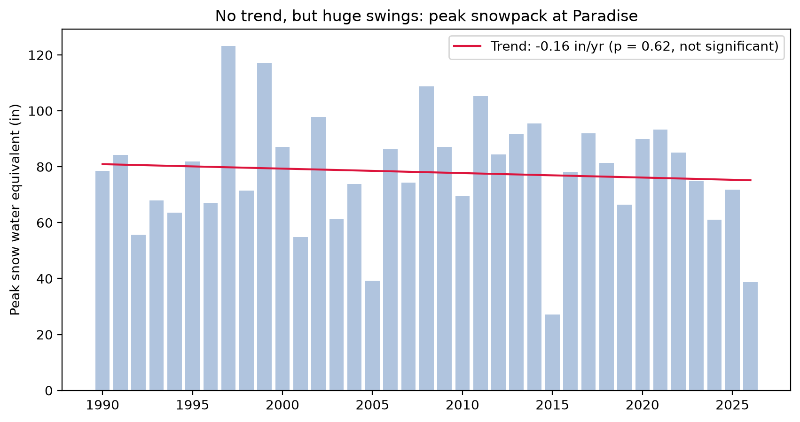
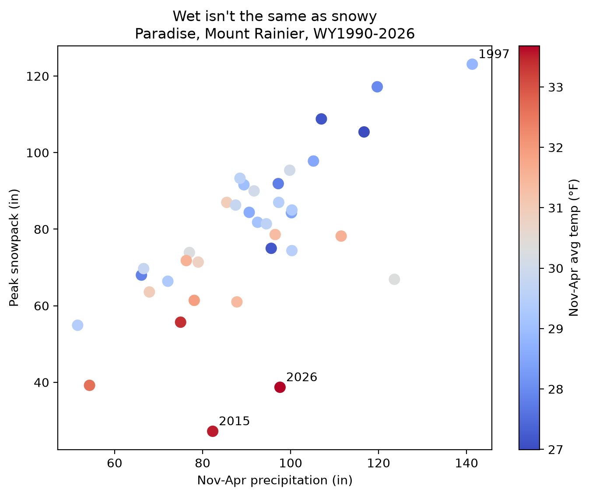
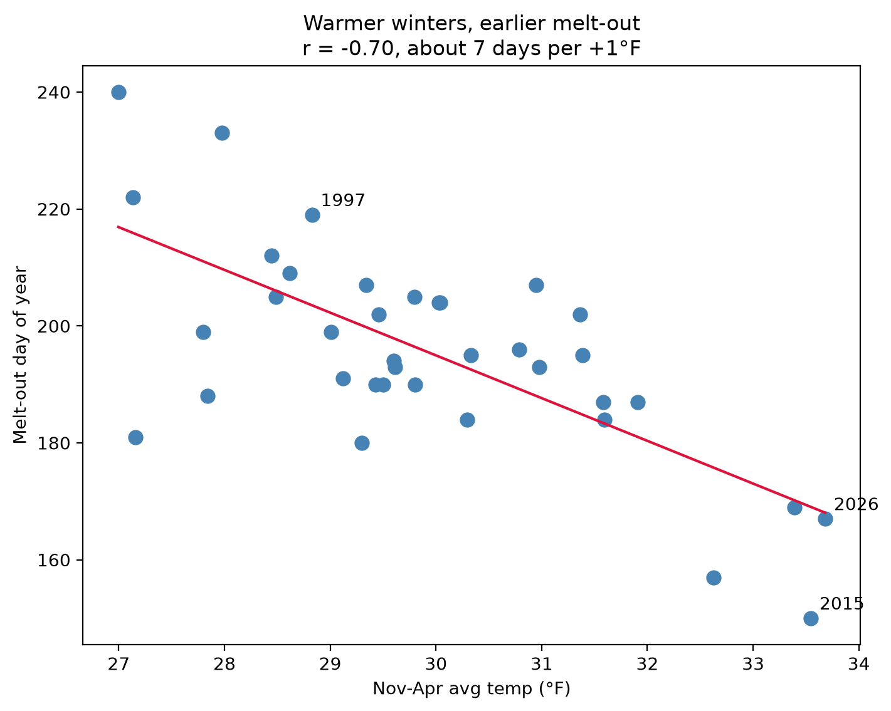

# rainier-snowpack
Does a wet winter mean a snowy winter at Mount Rainier? I analyzed 37 winters of Paradise SNOTEL data (1990-2026) in Python. Temperature and precipitation explain 72% of the swings in peak snowpack, and temperature matters more. Includes a winter scorecard, regression, and an animated visualization.

# Does a wet winter mean a snowy winter at Mount Rainier?

An analysis of 37 winters (water years 1990-2026) of daily snowpack, precipitation, and temperature data from the Paradise SNOTEL station on Mount Rainier's south side.

## Key findings
- **No trend, big swings.** Peak snowpack at Paradise ranges from 27 to 123 inches of snow water equivalent, with no statistically significant trend (-0.16 in/yr, p = 0.62). Winter temperature also shows no significant trend (+0.07 °F/decade, p = 0.80).
- **Temperature matters more than precipitation.** Peak snowpack correlates -0.73 with Nov-Apr temperature and +0.66 with Nov-Apr precipitation. A regression on both explains about 72% of the year-to-year variation: roughly -6.6 in per +1 °F, and +0.5 in per extra inch of precipitation.
- **Warm winters melt out earlier.** About 7 days earlier per +1 °F (r = -0.70).
- **Winter scorecard.** I ranked every winter on peak snowpack and melt-out date. Best: 1999. Worst: 2015. 2026 (the warmest winter, with above-average precipitation) ties for 35th of 37.





## Data
- Source: USDA NRCS SNOTEL, station 679 (Paradise, WA, 5,150 ft), via the NRCS AWDB REST API.
- Variables: snow water equivalent (WTEQ), accumulated precipitation (PREC), average air temperature (TAVG), daily.
- Window: water years 1990-2026 (Oct 1 to Sep 30). Pulled October 2026.

## Method
- Dropped snow depth (mostly missing). Water year 1989 was excluded because winter temperature coverage was 81%.
- Interpolated gaps of 3 days or fewer only; longer gaps were left missing.
- Per-winter summary: peak snowpack, peak date, melt-out date, Nov-Apr precipitation and mean temperature.
- Tests: linear regression for trends, correlation, and a two-variable regression.
- The scorecard is an index I created: peak snowpack and melt-out date, ranked and averaged.

## Caveats
- One station, 37 winters. Results show association, not cause.
- Nov-Apr temperature includes the early melt season, so part of the melt-out relationship is mechanical.
- This is not a statement about glaciers or other parts of the mountain.

## How to run
```
python3 -m venv .venv
source .venv/bin/activate
pip install -r requirements.txt
jupyter lab
```
Then open `01_analysis.ipynb`.

## Next
Forecasting a winter's peak snowpack from early-season data, and an automated live tracker.
